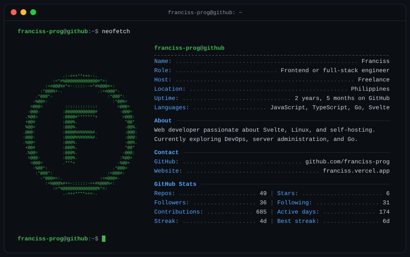
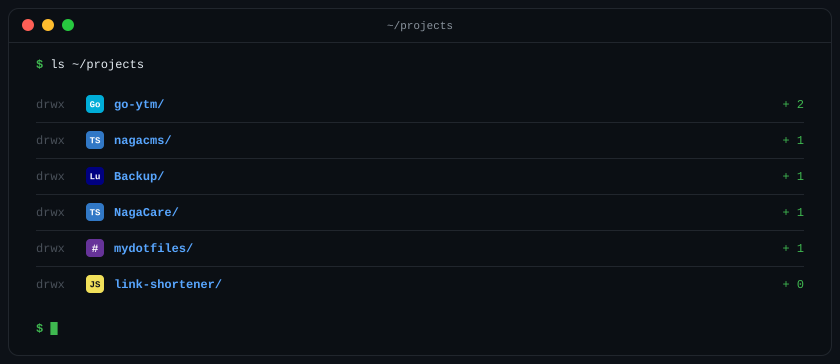
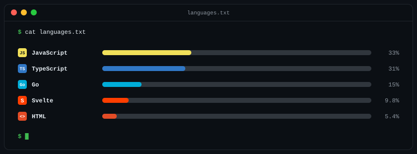
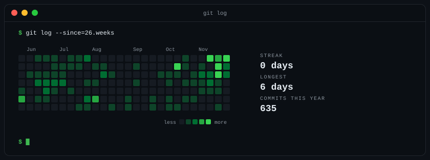

<!-- projects:start -->
<a href="https://github.com/Franciss-prog/go-ytm">go-ytm</a> · <a href="https://github.com/Franciss-prog/nagacms">nagacms</a> · <a href="https://github.com/Franciss-prog/Backup">Backup</a> · <a href="https://github.com/Franciss-prog/NagaCare">NagaCare</a> · <a href="https://github.com/Franciss-prog/mydotfiles">mydotfiles</a> · <a href="https://github.com/Franciss-prog/link-shortener">link-shortener</a>
<!-- projects:end -->

 
 

 
 

<code>~/links</code>

<a href="https://github.com/Franciss-prog">GitHub</a> · <a href="https://franciss.vercel.app">Website</a>

cards regenerate every 6 hours via GitHub Actions · <code>scripts/generate.mjs</code>

